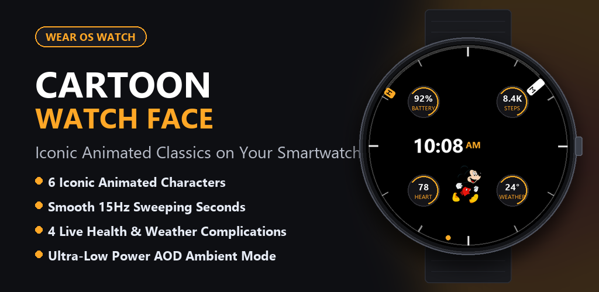
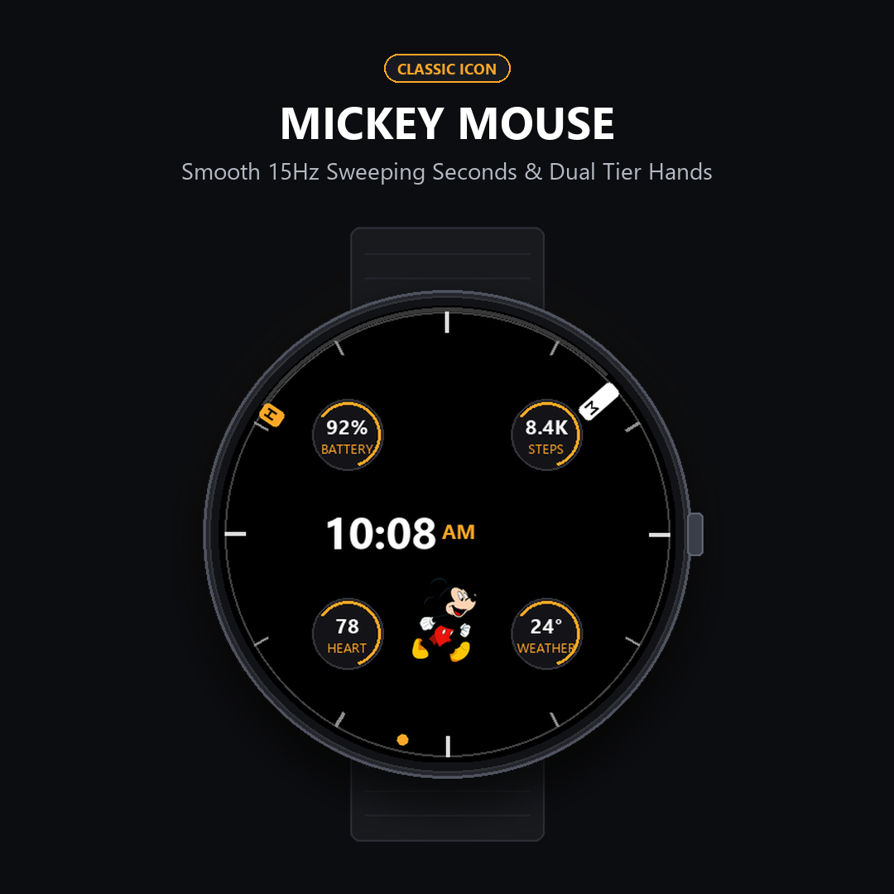
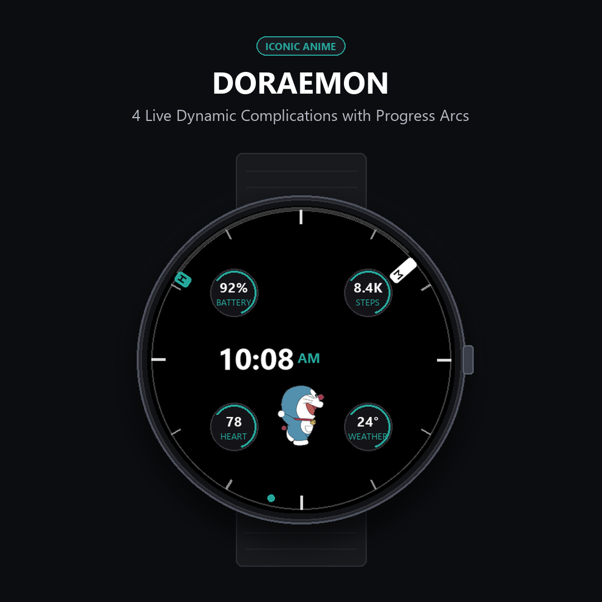
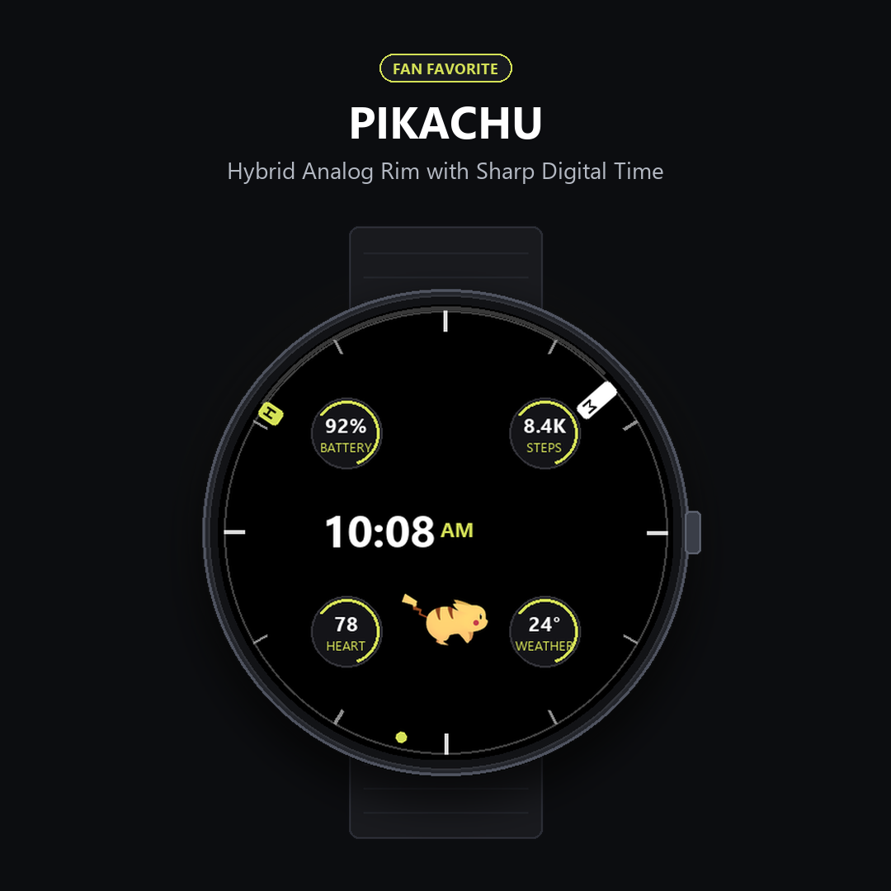
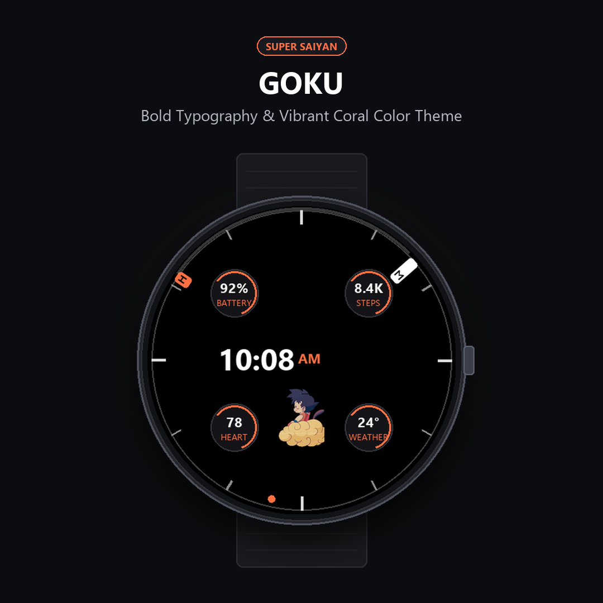
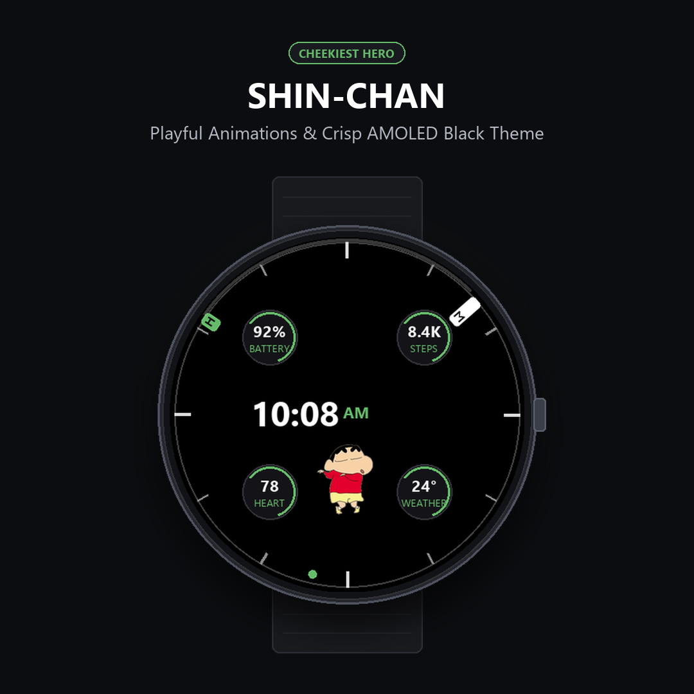
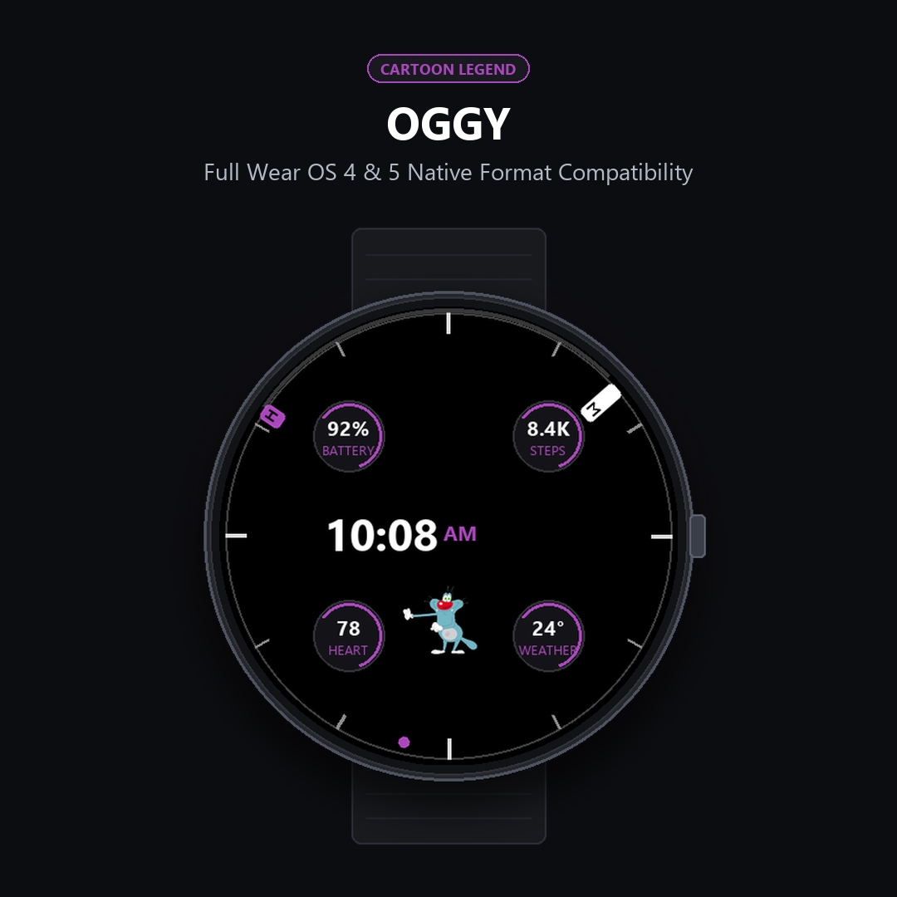
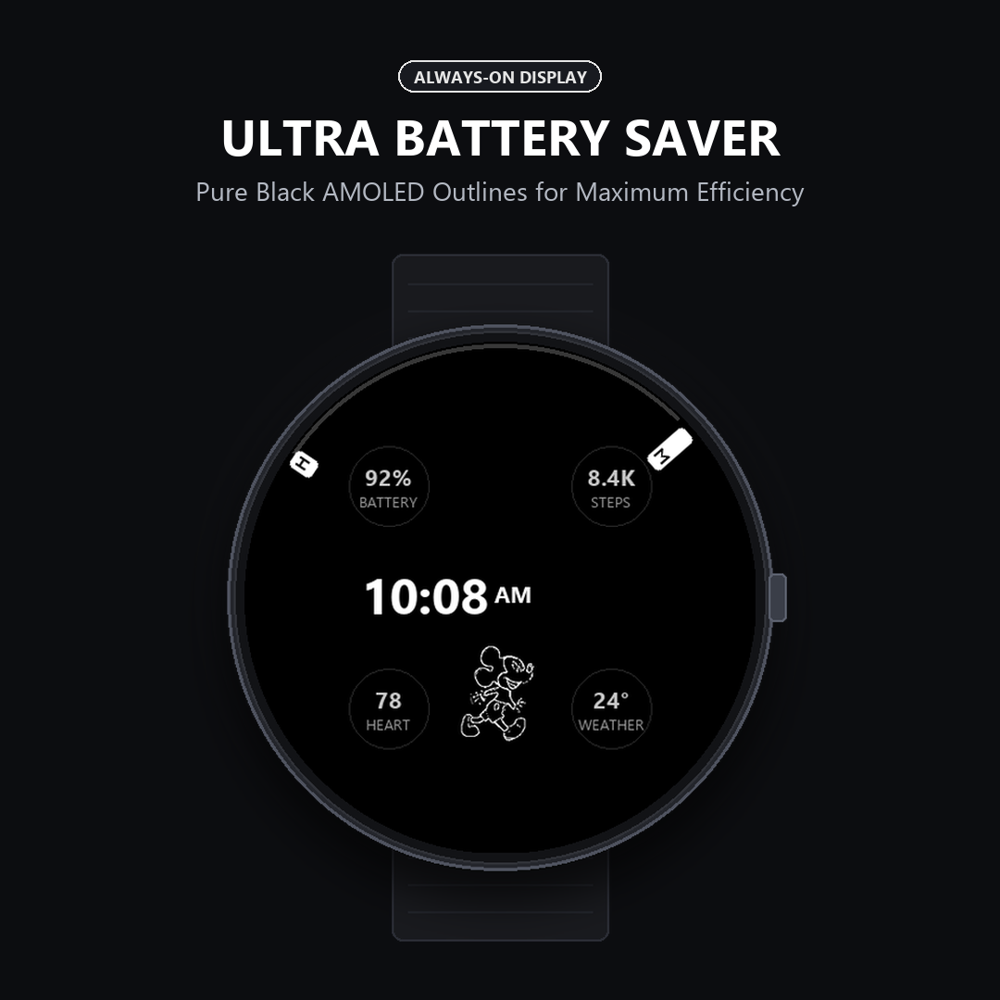

# ⌚ Cartoon Watch Face for Wear OS

> A battery-efficient, dual-display animated watch face for Wear OS smartwatches, built with Google's declarative **Watch Face Format (WFF v2)**.

[](https://developer.android.com/training/wearables/wff)
[](https://developer.android.com/training/wearables/wff)
[](LICENSE)
[](CartoonWatchFace/)
[](docs/architecture.md)
[](DISCLAIMER.md)

---

<p align="center">
  
</p>

---

## 📖 Overview

Traditional Wear OS watch faces run background Java/Kotlin service lifecycles that frequently wake the CPU, causing notable battery drain. **Cartoon Watch Face** solves this by adopting Google & Samsung's native **Watch Face Format (WFF v2)**, allowing the Wear OS system compositor to evaluate complications and render smooth character walk cycles directly at the OS level without any runtime bytecode.

The result is a responsive, AMOLED-optimized watch face that delivers retro nostalgia with smooth 15 Hz analog sweeping hands, 4 live health/system complications, and true all-day battery endurance.

---

## 📸 Screenshots & Showcase

| Mickey Mouse (Amber) | Doraemon (Teal) | Pikachu (Lime) |
| :---: | :---: | :---: |
|  |  |  |

| Goku (Coral) | Shin-chan (Mint) | Oggy (Lavender) |
| :---: | :---: | :---: |
|  |  |  |

<p align="center">
  <b>Always-On Display (AOD) Mode</b><br/>
  <i>Minimalist white outline silhouettes with battery-saving &lt;15% On-Pixel Ratio (OPR)</i><br/><br/>
  
</p>

---

## ✨ Key Features

- **6 Classic Animated Characters**: On-watch switcher for Mickey Mouse, Doraemon, Shin-chan, Pikachu, Goku, and Oggy with custom frame-by-frame walk cycles.
- **Dual Analog & Digital Display**: Prominent central digital clock in Google Sans Bold (76 pt) paired with peripheral analog hands reaching the outer bezel.
- **High-Contrast "H" & "M" Hands**: Distinct lettered hour and minute hands engineered to remain readable even when hands completely overlap at 12:00.
- **Smooth 15 Hz Sweeping Seconds**: Fluid seconds dot with a customizable toggle switch in settings (`showSeconds`).
- **4 PCD-Aligned Complications**: Positioned symmetrically at 45° diagonal angles with curved progress arcs for Battery, Steps, Heart Rate, and Weather/Date.
- **7 Curated Color Themes**: Amber (default), Electric Lime, Sunset Coral, Ocean Teal, Royal Lavender, Fresh Mint, and Monochrome White.
- **AMOLED-Optimized AOD**: Battery-safe ambient silhouettes preventing screen burn-in while maintaining glanceability.
- **Zero-DEX Pure WFF Architecture**: Packed with `android:hasCode="false"` and 0 `.dex` files for instant loading and 100% compliance with Google Play Store standards.

---

## 🛠 Tech Stack

- **Specification**: [Watch Face Format (WFF) Version 2](https://developer.android.com/training/wearables/wff)
- **Target OS**: Wear OS 5+ (Android 14 / `minSdk 34`, `targetSdk 36`)
- **Build System**: Gradle 9.1 with Android Gradle Plugin (AGP) 9.0.1
- **Asset Pipeline**: Python 3 (Pillow, NumPy) for mockups and Play Store asset generation
- **Package ID**: `com.main.cartoon`

---

## 📁 Project Structure

```text
Watch-face/
├── CartoonWatchFace/               # Android Wear OS application project
│   ├── app/
│   │   ├── build.gradle.kts        # Module build file with custom zero-DEX stripping hook
│   │   └── src/main/
│   │       ├── AndroidManifest.xml # WFF v2 manifest with android:hasCode="false"
│   │       └── res/
│   │           ├── drawable/       # Character sprites, hand indicators, bezel art
│   │           ├── font/           # Google Sans typography
│   │           ├── raw/
│   │           │   └── watchface.xml # Core declarative WFF layout & expressions
│   │           └── xml/            # Watch face shapes and metadata
│   ├── build.gradle.kts            # Root Gradle build script
│   └── gradle.properties           # Kotlin stdlib exclusion & build cache config
├── docs/                           # In-depth architectural & geometric documentation
│   ├── architecture.md             # WFF v2 runtime & zero-DEX build pipeline details
│   └── complications-and-layout.md # PCD geometry, hand layering, and color palette
├── listing_assets/                 # Generated Play Store assets (512x512 icon, 1024x500 banner, screenshots)
├── generate_all_assets.py          # Automated Python script to generate marketing graphics
├── Cartoon.aab                     # Production Android App Bundle for Google Play Console
├── Cartoon.apk                     # Pre-built release APK for direct sideloading
├── requirements.txt                # Python dependencies for marketing asset generator
├── LICENSE                         # MIT License
└── README.md                       # Repository overview and documentation
```

---

## 🚀 Getting Started

### Prerequisites

1. **Android Studio**: Ladybug / Meerkat or later (with Android SDK 34+ installed).
2. **Java Development Kit (JDK)**: JDK 17 or JDK 21.
3. **Physical Watch or Wear OS Emulator**: Wear OS 4 or 5 (`API 33` or `34+`).

### Building from Source

Clone the repository and compile using the Gradle wrapper:

```bash
# Clone the repository
git clone https://github.com/ParvShah2001/Watch-face.git
cd Watch-face/CartoonWatchFace

# Assemble the signed release APK
./gradlew clean :app:assembleRelease

# Build the Google Play Android App Bundle (AAB)
./gradlew :app:bundleRelease
```

Build outputs will be generated at:
- **APK**: `app/build/outputs/apk/release/app-release.apk`
- **AAB**: `app/build/outputs/bundle/release/app-release.aab`

---

## 📲 Installation & Sideloading

You can install the pre-compiled APK directly onto a smartwatch over wireless debugging via Android Debug Bridge (ADB):

1. **Enable Developer Options on your Watch**:
   - Go to **Settings > System > About > Versions**.
   - Tap **Build number** 7 times until Developer Mode is unlocked.
   - Go to **Settings > Developer Options** and enable **ADB debugging** and **Wireless debugging**.

2. **Connect via ADB**:
   ```bash
   adb connect <WATCH_IP_ADDRESS>:<PORT>
   ```

3. **Install the APK**:
   ```bash
   adb install -r Cartoon.apk
   ```

4. **Activate the Watch Face**:
   - Long-press your current watch face on the watch.
   - Scroll right and tap **Add watch face (`+`)**.
   - Select **Cartoon** from the downloaded section.

---

## ⚙️ Customization Guide

On your smartwatch, long-press the watch face and tap **Customize**:

| Option | Setting ID | Options / Values | Description |
| :--- | :--- | :--- | :--- |
| **Character** | `character` | Mickey (0), Doraemon (1), Shin-chan (2), Pikachu (3), Goku (4), Oggy (5) | Switches the animated walk cycle and ambient silhouette |
| **Color Theme** | `themeColor` | Amber, Lime, Coral, Teal, Lavender, Mint, White | Applies two-tone accent palettes across digits, arcs, and hands |
| **Show Seconds** | `showSeconds` | `ON` / `OFF` (Boolean) | Toggles the 15 Hz peripheral sweeping seconds dot |
| **Complications** | `slotId 1..4` | Any Wear OS Provider | Configures 4 circular data slots (Battery, Steps, Heart, Weather) |

---

## 🎨 Asset Generation Tooling

To regenerate promotional graphics, high-resolution device mockups, and application icons:

```bash
# Install Python dependencies
pip install -r requirements.txt

# Run the automated generator
python generate_all_assets.py
```

Outputs are automatically saved to `listing_assets/`:
- `feature_graphic_1024x500.png` (Google Play Feature Banner)
- `icon_512.png` (512x512 High-Resolution Store Icon)
- `screenshot_1..7.png` (1080x1080 Smartwatch Store Screenshots)

---

## 🗺 Roadmap

- [x] Initial Watch Face Format (WFF v2) implementation
- [x] Symmetrical 45° PCD complication alignment
- [x] Overlap-proof "H" and "M" hand indicators
- [x] Automated Zero-DEX compilation hook for Google Play Console compliance
- [ ] Additional character walk cycle options (e.g. Tom & Jerry, Dragon Ball Vegeta)
- [ ] Customizable digital font weight variants
- [ ] User-defined date format toggles (DD/MM vs MM/DD)

---

## 🤝 Contributing

Contributions, feature suggestions, and bug reports are welcome!

1. Fork the Project.
2. Create your Feature Branch (`git checkout -b feature/NewFeature`).
3. Commit your Changes (`git commit -m "Add NewFeature"`).
4. Push to the Branch (`git push origin feature/NewFeature`).
5. Open a Pull Request.

Please ensure any changes to `watchface.xml` adhere to the [official Watch Face Format XML schema](https://developer.android.com/training/wearables/wff).

---

## 📄 License

This software and its build configurations are open-source and licensed under the [MIT License](LICENSE).

---

## ⚖️ Fan-Art & Parody Licensing Declaration

> **Google Play Developer Policy & Trademark Notice:**
>
> **Cartoon Watch Face** is an independent, non-commercial fan-art and parody application designed strictly for educational demonstration of the Wear OS **Watch Face Format (WFF v2)**.
>
> - **Non-Affiliation**: This application is **NOT** an official product and is not affiliated with, endorsed by, sponsored by, or associated with Disney, Fujiko-Pro, Shin-ei Animation, TV Asahi, Nintendo, The Pokémon Company, Shueisha, Toei Animation, or Xilam Animation.
> - **Ownership**: All character names, logos, likenesses, and associated intellectual property remain the exclusive property of their respective copyright and trademark owners.
> - **Non-Commercial Fair Use**: Distributed 100% free of charge with **zero monetization, zero advertisements, and zero in-app purchases** as transformative fan tribute under Fair Use and Parody principles.
>
> For full legal terms or copyright takedown inquiries, please refer to [`DISCLAIMER.md`](DISCLAIMER.md).

---

## 👨‍💻 Author

**Parv Shah**
- **GitHub**: [@ParvShah2001](https://github.com/ParvShah2001)
- **Email**: [parvshah240@gmail.com](mailto:parvshah240@gmail.com)
